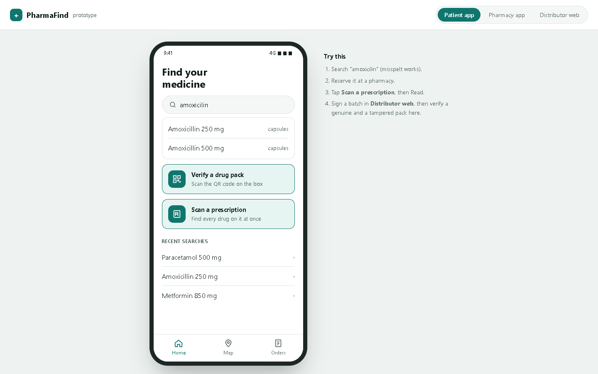
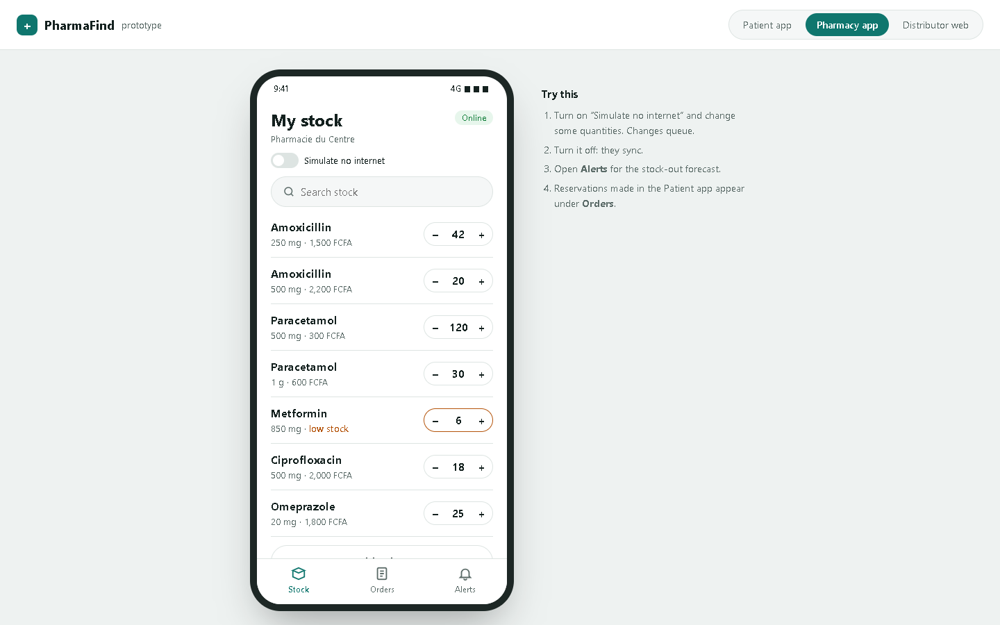
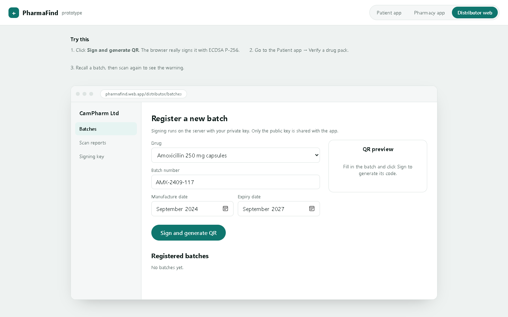

# PharmaFind

A clickable prototype for finding medicines at nearby pharmacies and checking that a drug pack is genuine. It has three connected apps in one page: a **patient app**, a **pharmacy app** and a **distributor dashboard**.

**[Try it →](https://wrightmua.github.io/PharmaFind/)**

| Patient app | Pharmacy app | Distributor dashboard |
|---|---|---|
|  |  |  |

## What's in it

**Patient app**
- Search a drug, and typos still match ("amoxicilin" finds Amoxicillin)
- See nearby pharmacies as a list or on a map, with price and stock
- Reserve a drug and get a pickup code
- Verify a drug pack: genuine / tampered / unknown supplier / recalled
- Scan a prescription to find every drug on it, then rank pharmacies that stock them all

**Pharmacy app**
- Update stock with + / − buttons
- "Simulate no internet": changes queue offline and sync when the connection returns
- Stock-out forecast alerts using exponential smoothing (α = 0.3)
- Orders: reservations made from the patient app

**Distributor dashboard**
- Register a batch and sign it with a real **ECDSA P-256** signature in the browser (Web Crypto API)
- Recall a batch
- See reports of fake packs sent in by patients

## Demo walkthrough

1. **Distributor web** → *Sign and generate QR*
2. **Patient app** → *Verify a drug pack* → scan a genuine pack → **Genuine**
3. Scan a tampered pack (expiry changed after signing) → **Do not use**
4. **Distributor web** → recall the batch → scan again → **Warning**

## Notes

- Single HTML file with no dependencies, and it works offline. Open `index.html` in Chrome or Edge.
- Sample data is set in Buea, Cameroon (prices in FCFA) and resets on reload.
- The signature, prescription matching and forecast are real algorithms. The camera, GPS and Firebase backend are simulated; they're planned for the Flutter build.
